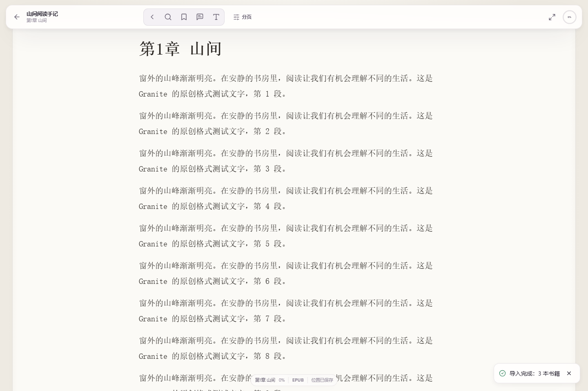
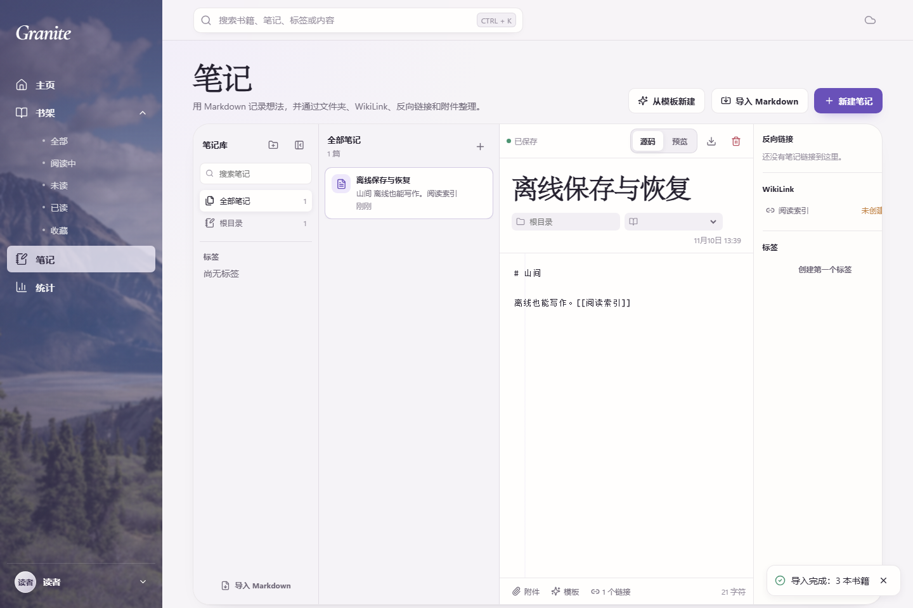

<div align="center">


# Granite

免费、开源、本地优先的私人数字书房。面向 Windows 与 Android。

<p>
  <a href="LICENSE"></a>
  <a href="https://github.com/vexpaer/granite/releases/tag/v0.1.0"></a>
  <a href="https://github.com/vexpaer/granite/actions/workflows/windows.yml"></a>
  <a href="https://github.com/vexpaer/granite/actions/workflows/android.yml"></a>
</p>

<p>
  <a href="#下载">下载</a>
  &nbsp;·&nbsp;
  <a href="#特性">特性</a>
  &nbsp;·&nbsp;
  <a href="#使用">使用</a>
  &nbsp;·&nbsp;
  <a href="#从源码构建">构建</a>
  &nbsp;·&nbsp;
  <a href="#文档">文档</a>
  &nbsp;·&nbsp;
  <a href="#许可证">许可证</a>
</p>

</div>

Granite 是电子书阅读器和个人书库。书籍、标注、笔记、进度和插件数据保存在本机；阅读不依赖 Granite 账号或常驻服务器。界面为简体中文，技术栈是 Tauri 2、Rust、Vue 3、TypeScript 与 Cordis。运行已安装的应用不需要 Node.js。

## 特性

- 阅读 EPUB、PDF、TXT 与 MOBI。PDF 按范围加载；标注可以写回原文件。需要完整缓冲的操作上限为 512 MiB。
- 每台设备可以使用多个书库文件夹。移除书库只解除关联，源文件保留在磁盘上。
- Markdown 笔记支持文件夹、标签、模板、附件、预览、WikiLink、反向链接，以及书籍引文和阅读位置。
- 统计、日历、连续阅读和目标由真实阅读会话计算。
- 可以导出备份。同步可选，一次使用一个 WebDAV 或 S3 兼容配置；密钥写入系统凭据存储。
- Cordis 插件可从本地包或明确的 HTTPS 地址安装。安装前展示来源、作者、版本、许可证、完整性、兼容性与权限，确认后默认关闭。
- Windows 使用侧栏；Android 竖屏使用底部导航，横屏使用侧栏。阅读时导航让出整个画面。

<p align="center">
  
</p>

<p align="center">
  
  &nbsp;
  
</p>

## 下载

当前发布为 [v0.1.0](https://github.com/vexpaer/granite/releases/tag/v0.1.0)。

| 平台 | 安装包 | 说明 |
| --- | --- | --- |
| Windows x64 | [Granite-0.1.0-windows-x64-setup.exe](https://github.com/vexpaer/granite/releases/download/v0.1.0/Granite-0.1.0-windows-x64-setup.exe) | 8.04 MB，NSIS，未做代码签名，需要 WebView2 |
| Android ARM64 | [Granite-v0.1.0-aarch64.apk](https://github.com/vexpaer/granite/releases/download/v0.1.0/Granite-v0.1.0-aarch64.apk) | 22.97 MB，发布密钥签名，Android 7.0（API 24）起 |

校验和见 [SHA256SUMS](https://github.com/vexpaer/granite/releases/download/v0.1.0/SHA256SUMS)。

安装包由 GitHub Actions 完成类型检查、单元测试、原生检查、打包和校验和核验。实机运行与真实云端同步不在这套自动化里，记录为未验证。见 [CI 流程](docs/ci.md)。

## 使用

安装后直接打开。首页在书库为空时提供导入和选择书库文件夹；已有数据时显示继续阅读、最近阅读、最近笔记、统计、今日目标和标签。这六个模块可以排序或隐藏。

在首页或书库导入 EPUB、PDF、TXT、MOBI，或选择书库文件夹。Windows 使用系统文件夹选择，Android 使用存储访问框架。书库提供网格和列表、搜索、状态与来源筛选、合集、标签和批量选择。文件缺失时可以重新定位或校验后重新关联，书籍身份和标注保持不变。

阅读器提供目录、书内搜索、书签、标注和外观。默认快捷键如下，可在设置中修改：

| 操作 | 默认按键 |
| --- | --- |
| 全局搜索 | `Ctrl+K`；阅读器外、非输入状态下也可按 `/` |
| 上一页 / 下一页 | `←` / `→` |
| 书签 | `B` |
| 全屏 | `F` |

笔记是独立的 Markdown 空间，保存状态按篇显示。统计页的时长、趋势和目标都来自阅读会话，空白日期保持空白。

同步在「同步与存储」中配置一个 WebDAV 或 S3 兼容配置。未配置或尚未成功同步时，状态保持等待。冲突保留双方版本，直到手动选择。密钥不进入普通设置、诊断导出或备份。

插件在安装确认后默认关闭。未获信任的插件界面运行在 Worker 或 iframe 中。安全模式关闭第三方插件，核心页面仍可使用。

## 从源码构建

依赖安装、检查、签名和打包只在 GitHub-hosted Actions 上执行。本机保留源码和 Git 工作副本，不安装 Node、Rust、JDK 或 Android SDK。

推送和拉取请求会运行：

| 工作流 | 内容 |
| --- | --- |
| [Windows](.github/workflows/windows.yml) | 前端类型检查、单元测试与构建；MSVC 原生测试和 `cargo check`；未签名的 NSIS x64 安装包。产物保留 14 天 |
| [Android](.github/workflows/android.yml) | 同样的前端检查；ARM64 Debug APK；Android 桥接的 JVM 单元测试与清单、校验和检查 |

两个工作流都可以在 Actions 页面手动运行。Windows 的手动运行与普通推送相同。Android 的手动运行生成发布密钥签名的候选 APK，不创建 Release。

发布前先更新源码中的版本号，然后推送 `v*` 标签：

```powershell
git tag vX.Y.Z
git push origin vX.Y.Z
```

标签会让两个工作流构建并上传到同一个 GitHub Release，分别附带 `SHA256SUMS.windows` 与 `SHA256SUMS.android`。Windows 安装包不签名。Android 使用仓库里配置的签名 Secrets，目标为 `aarch64`，不生成 AAB，也不启动模拟器。

工作流使用 Node.js 22、稳定版 Rust 和 Temurin 17。Android 编译使用 SDK 37 与 NDK 29。Rust 包声明的最低版本为 1.77.2。

根目录的 `CLEAN-LOCAL.cmd` 只删除脚本列出的、可以重建的本机文件，并保留源码、Git 和 `private/signing`。

## 项目结构

```text
src/                    Vue 3 界面、页面和阅读器
src/stores/app.ts       界面状态边界
src/types.ts            共享模型
src/reader/             EPUB、PDF、TXT、MOBI 解析
packages/core/          同步、插件运行时、笔记链接与统计
src-tauri/              Tauri 2 宿主；私有 SQLite、文件、凭据与网络
native/android-bridge/  Android 存储访问框架、Keystore 与生命周期
public/                 前端静态资源
docs/                   架构、契约、验收与 CI
.github/workflows/      Windows 与 Android 检查和打包
```

共享模型在 `src/types.ts`。界面状态集中在 `src/stores/app.ts`，原生能力经命令 `host_call` 进入 Rust 宿主。宿主负责文件、私有 SQLite、HTTP 与凭据。Windows 使用系统凭据管理器，Android 使用 Keystore。密钥不写入普通设置。

## 文档

- [规格书](granite%20规格书/Granite%20规格书.md)
- [验收记录](docs/acceptance.md)
- [架构决策](docs/architecture-decisions.md)
- [实现契约](docs/implementation-contract.md)
- [CI 流程](docs/ci.md)
- [当前更正](docs/task-overrides.md)
- [第三方素材来源](public/assets/SOURCES.md)

首版范围是 Windows 桌面和 Android。Linux 与网页阅读器不在此范围内。

## 许可证

主项目为 [AGPL-3.0-only](LICENSE)。第三方依赖保留各自的许可证。

请勿向仓库提交个人书籍、云存储密钥或 Android 签名材料。
